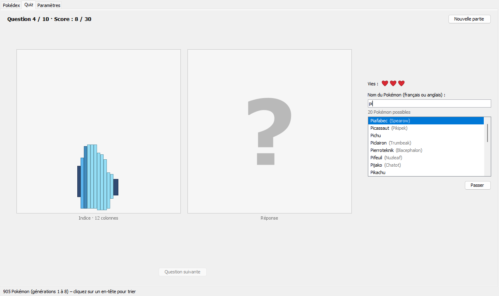
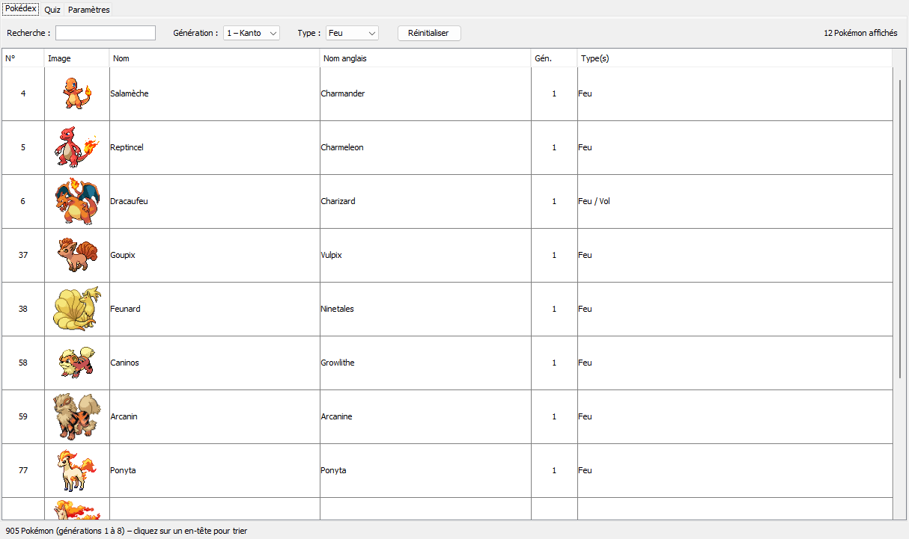
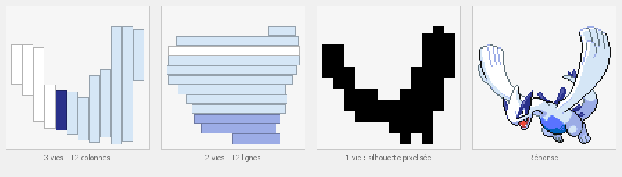
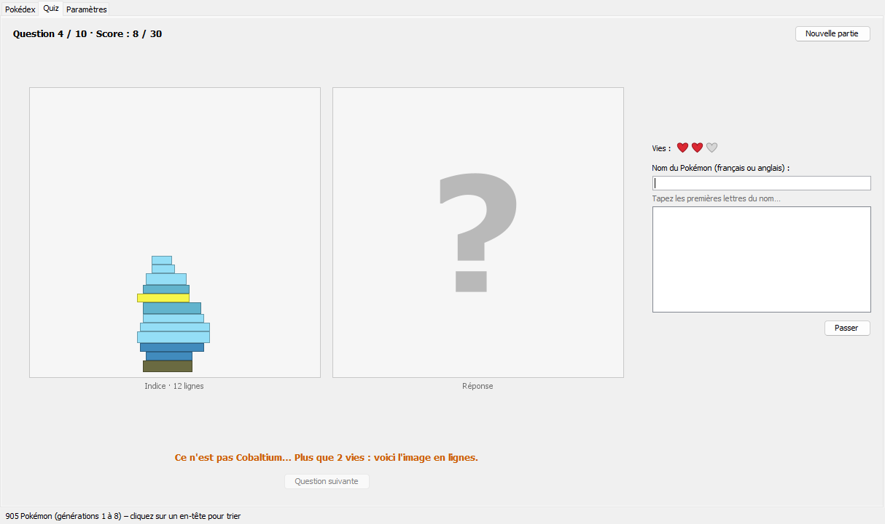
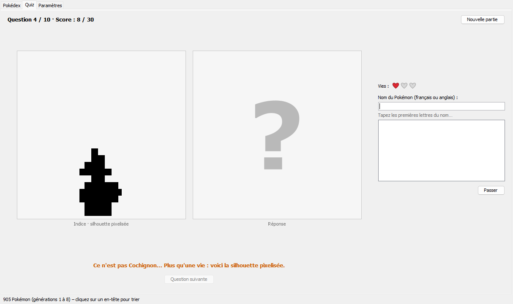
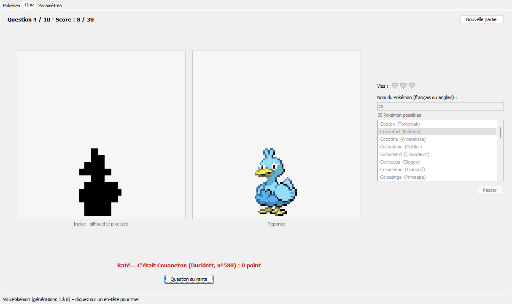
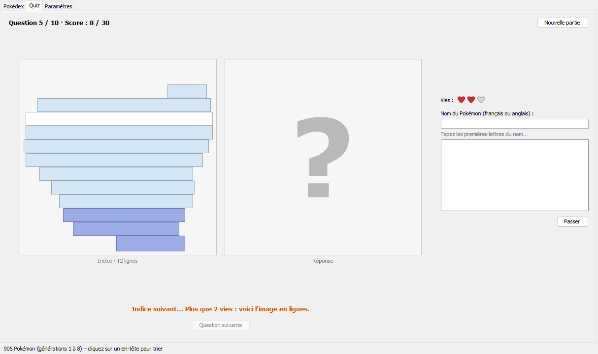
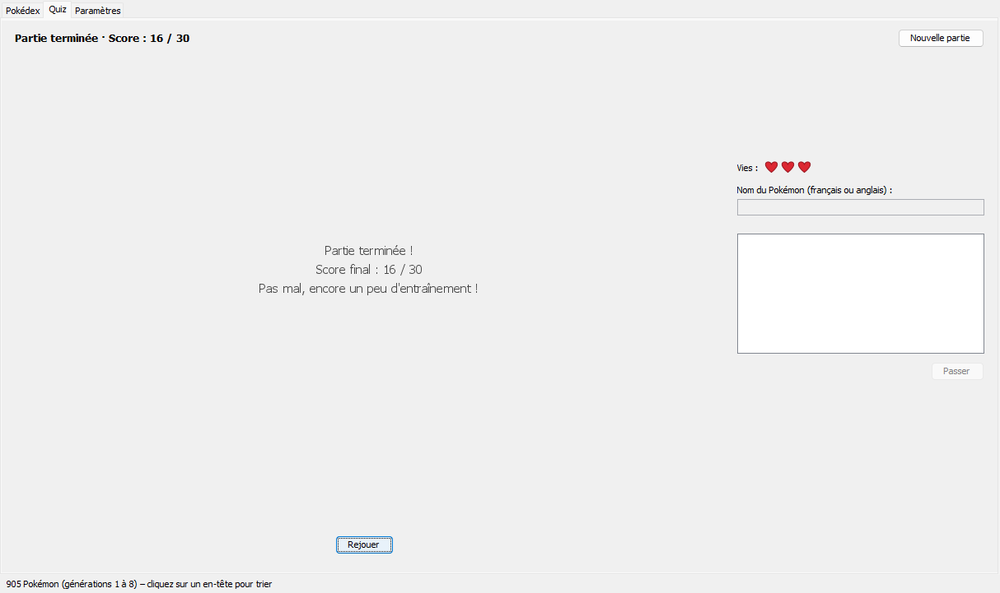
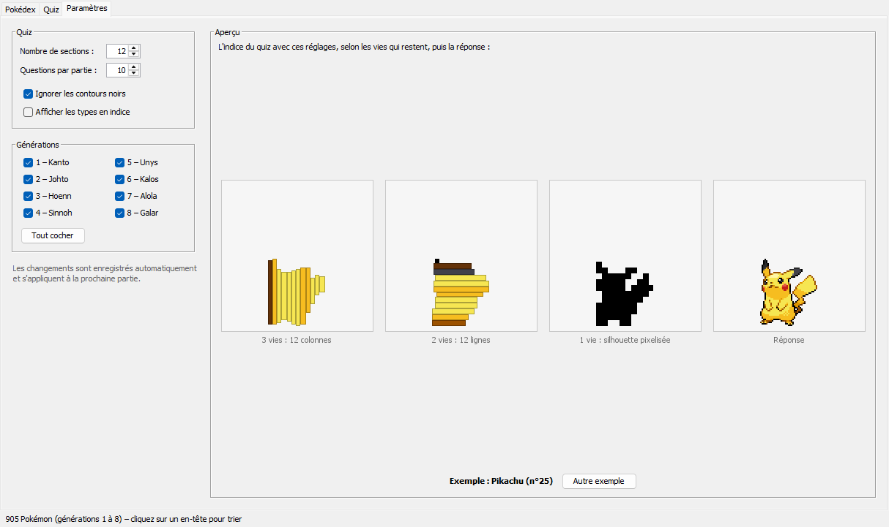

# Pokédex Java

Application de bureau en Java Swing, réalisée dans le cadre d'un cours à SDV :
un Pokédex des 905 Pokémon des générations 1 à 8 (données de [PokéAPI](https://pokeapi.co/))
et un quiz pour retrouver un Pokémon à partir de ses bandes de couleurs, puis de sa silhouette pixelisée.



## Fonctionnalités

- **Pokédex** : un tableau avec le numéro de chaque Pokémon, son image, ses noms français et anglais,
  sa génération et ses types. Un clic sur un en-tête trie la colonne.
  - **Recherche** : le tableau ne garde que les Pokémon dont le nom français ou anglais contient le texte tapé,
    sans tenir compte des accents ni des majuscules (« chu » trouve Pikachu, Raichu, Pichu…).
    Un nombre cherche le numéro : « 25 » trouve Pikachu. Le tableau change à chaque lettre tapée.
  - **Filtres** : une liste « Génération » (Toutes, 1 – Kanto … 8 – Galar) et une liste « Type »
    (Tous, puis les 18 types dans l'ordre alphabétique). La recherche et les deux filtres se combinent.
  - Le nombre de Pokémon affichés est indiqué à droite (« 12 Pokémon affichés »,
    « Aucun Pokémon ne correspond »), et « Réinitialiser » vide la recherche et les filtres.
- **Quiz des couleurs** : il faut retrouver un Pokémon tiré au hasard à partir d'un indice, qui change
  à chaque erreur. Les deux premiers indices découpent son sprite en bandes : chaque bande montre la couleur
  la plus fréquente de sa partie de l'image et la place qu'y prend le Pokémon (par défaut, les contours noirs
  du dessin ne comptent pas dans la couleur).
  - **3 vies par Pokémon, un indice par vie** :
    - 3 vies (au départ) : des **colonnes verticales**, 12 par défaut (le réglage « Nombre de sections »),
      sans dépasser la largeur du Pokémon en pixels ;
    - 2 vies : le même nombre de **lignes horizontales**, sans dépasser sa hauteur ;
    - 1 vie : la **silhouette pixelisée** du Pokémon, à la même taille et à la même place que son sprite.
      Le Pokémon est découpé en cases carrées, environ 12 × 12 (le même réglage : 12 cases au plus
      sur son plus grand côté), et une case est noire si le Pokémon en remplit au moins la moitié.
      La forme générale reste, mais les détails fins (oreilles, queue, pattes) disparaissent ;
    - quand la dernière vie est perdue, le Pokémon est dévoilé.
  - **« Passer »** montre l'indice suivant, mais coûte une vie, comme une erreur (sans compter de mauvais
    Pokémon). Avec une seule vie, « Passer » perd la question.
  - **Points** : un Pokémon trouvé rapporte les vies qui restent, donc 3 points du premier coup,
    2 points au 2e essai et 1 point au 3e (« Passer » compte comme un essai). Une question perdue rapporte
    0 point. Le score est sur 3 × le nombre de questions (30 pour 10 questions) ; il s'affiche en haut
    pendant la partie (« Question 4 / 10 · Score : 8 / 30 ») et à la fin, avec un petit commentaire.
  - **Réponse avec autocomplétion** : on tape les premières lettres du nom, en français ou en anglais
    (majuscules, accents et ponctuation ne comptent pas). La liste sous le champ ne garde que les Pokémon
    qui commencent ainsi, par exemple « Dracaufeu (Charizard) » pour « chari ». Les Pokémon trouvés
    par leur nom français viennent d'abord, puis ceux trouvés par leur nom anglais, chaque groupe
    dans l'ordre alphabétique. On choisit avec les flèches ↑ ↓ puis Entrée, ou d'un clic.
  - Une mauvaise réponse coûte une vie (les cœurs au-dessus du champ) et le Pokémon proposé
    disparaît de la liste.
- **Paramètres** : nombre de sections (1 à 32, 12 par défaut : le nombre de colonnes, puis de lignes,
  puis de cases sur le plus grand côté de la silhouette pixelisée),
  nombre de questions (1 à 50), contours noirs ignorés ou non (pour les colonnes et les lignes),
  types en indice et générations utilisées par le quiz (la liste des réponses ne propose que ces générations).
  Un aperçu montre les trois indices et la réponse, et les réglages sont enregistrés automatiquement.
  Le sens des bandes ne se règle plus : il dépend des vies qui restent.





| Après une erreur : 2 vies, 12 lignes | Après deux erreurs : 1 vie, la silhouette pixelisée |
|---|---|
|  |  |

| Réponse ratée : 0 point | Après « Passer » : 2 vies, 12 lignes |
|---|---|
|  |  |

| Fin de partie | Onglet Paramètres |
|---|---|
|  |  |

## Prérequis

- **JDK 27** (le code est compilé avec `--release 27`).
- Maven n'a pas besoin d'être installé : le *Maven Wrapper* (`mvnw.cmd` sous Windows, `mvnw` sous Linux et macOS)
  télécharge lui-même la bonne version de Maven la première fois.
- Une connexion Internet au premier lancement, pour télécharger les Pokémon depuis PokéAPI.

## Lancer l'application sous Windows

Double-cliquer sur `lancer.cmd` à la racine du projet : le script compile le projet avec le Maven Wrapper
(sans relancer les tests), puis ouvre l'application. Il cherche le JDK 27 dans `JAVA_HOME`,
sinon dans `%USERPROFILE%\.jdks\openjdk-27`.

## Lancer le projet dans IntelliJ IDEA

1. **File › Open…** puis choisir le dossier du projet.
2. IntelliJ reconnaît le projet Maven grâce au `pom.xml` et télécharge les dépendances.
   S'il ne le propose pas : clic droit sur `pom.xml` › **Add as Maven Project**.
3. Vérifier le JDK : **File › Project Structure… › Project › SDK** = JDK 27.
4. Ouvrir `src/main/java/fr/sdv/pokedex/Main.java` et cliquer sur ▶ à côté de `main`.
   Le dossier de travail doit rester la racine du projet (valeur par défaut) :
   c'est là que l'application range `cache/` et `parametres.properties`.
5. Pour les tests : clic droit sur `src/test/java` › **Run 'All Tests'**.

## En ligne de commande

Depuis la racine du projet, dans PowerShell (la variable `JAVA_HOME` doit indiquer le JDK 27,
sinon c'est le `java` du `PATH` qui est utilisé) :

```powershell
.\mvnw.cmd test                              # compile et lance les tests
.\mvnw.cmd package                           # crée le jar exécutable (après les tests)
java -jar target\pokedex-1.0-SNAPSHOT.jar    # lance l'application
```

Sous Linux ou macOS, remplacer `.\mvnw.cmd` par `./mvnw`.

Le jar contient tout ce qu'il faut, bibliothèque Jackson comprise : on peut le copier ailleurs.
Il crée `cache/` et `parametres.properties` dans le dossier d'où on le lance.

## Structure du projet

```text
.
├── pom.xml                         configuration Maven : dépendances, plugins, jar exécutable
├── mvnw, mvnw.cmd, .mvn/wrapper/   Maven Wrapper
├── lancer.cmd                      double-clic : compile puis ouvre l'application (Windows)
├── src/main/java/fr/sdv/pokedex/
│   ├── Main.java                   point d'entrée
│   ├── FenetrePokedex.java         fenêtre principale (onglets Pokédex, Quiz, Paramètres)
│   ├── ChargementPokedex.java      thread de chargement : liste des Pokémon, puis images du tableau
│   ├── ApiPokemon.java             appels à PokéAPI et lecture du JSON avec Jackson
│   ├── CachePokedex.java           fichier cache/pokedex.csv
│   ├── CacheImages.java            images téléchargées une fois, puis gardées dans cache/sprites/
│   ├── Pokemon.java                un Pokémon (numéro, noms, génération, types, image)
│   ├── PanneauPokedex.java         onglet Pokédex : recherche, filtres et tableau
│   ├── FiltrePokedex.java          recherche et filtres du Pokédex, sans interface graphique
│   ├── ModeleTableau.java          contenu du tableau : tous les Pokémon et ceux qui passent les filtres
│   ├── Bandes.java, Bande.java     découpage d'une image en colonnes ou en lignes de couleurs
│   ├── SilhouettePixelisee.java    silhouette en cases carrées (le dernier indice)
│   ├── PartieQuiz.java             déroulement d'une partie (vies, indice, points), sans interface graphique
│   ├── Suggestions.java            Pokémon proposés sous le champ de réponse, sans interface graphique
│   ├── Parametres.java             réglages du quiz
│   └── PanneauQuiz.java, PanneauParametres.java, PanneauBandes.java,
│       RenduSuggestion.java, IconeVies.java                     interface du quiz
├── src/test/java/fr/sdv/pokedex/   37 tests JUnit (sans réseau ni fenêtre)
└── docs/images/                    captures d'écran de ce README
```

## Fichiers locaux

L'application crée ces fichiers dans son dossier de travail. Ils sont propres à chaque machine
et ignorés par Git (voir `.gitignore`) :

- `cache/pokedex.csv` : la liste des Pokémon, téléchargée une seule fois, comme le demande PokéAPI.
  Le premier téléchargement se fait Pokémon par Pokémon et prend quelques minutes (barre de progression en bas).
  Supprimer ce fichier force un nouveau téléchargement. Une ligne par Pokémon, champs séparés par `;` :
  `id;nom;nom_anglais;generation;types;image` (par exemple `6;Dracaufeu;Charizard;1;Feu/Vol;https://…/6.png`).
  Un fichier d'une ancienne version (avec la taille, le poids et les statistiques) est reconnu à son en-tête :
  la liste est alors téléchargée à nouveau, une seule fois, et les images déjà dans `cache/sprites/` sont gardées.
- `cache/sprites/` : les images des Pokémon, téléchargées une par une après la liste.
- `parametres.properties` : les réglages du quiz. Un fichier créé par une ancienne version reste lisible :
  il garde son nombre de sections (par exemple 8), et l'ancienne clé `sens` est ignorée.

## Crédits

- Données et sprites : [PokéAPI](https://pokeapi.co/) (images du dépôt [PokeAPI/sprites](https://github.com/PokeAPI/sprites)).
- Pokémon © Nintendo / Game Freak / Creatures. Projet étudiant non officiel, sans lien avec ces sociétés.
- Bibliothèques : [Jackson](https://github.com/FasterXML/jackson) pour le JSON, [JUnit](https://junit.org/) pour les tests.
