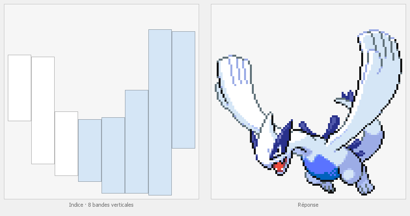
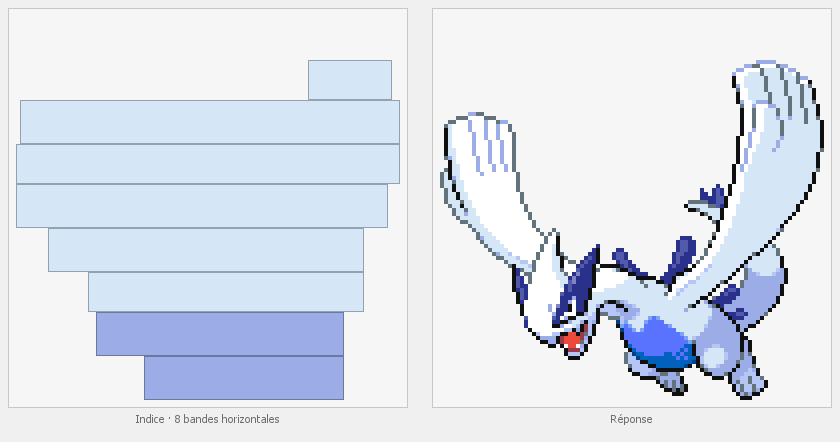

# Pokédex Java

Application de bureau en Java Swing, réalisée dans le cadre d'un cours à SDV :
un Pokédex des 905 Pokémon des générations 1 à 8 (données de [PokéAPI](https://pokeapi.co/))
et un quiz pour retrouver un Pokémon à partir de ses seules bandes de couleurs.


## Fonctionnalités

- **Pokédex** : un tableau avec l'image de chaque Pokémon, ses noms français et anglais, sa génération,
  ses types, sa taille, son poids et ses statistiques. Un clic sur un en-tête trie la colonne.
- **Quiz des couleurs** : le sprite d'un Pokémon tiré au hasard est découpé en bandes horizontales
  ou verticales. Chaque bande montre la couleur la plus fréquente de sa partie de l'image et la place
  qu'y prend le Pokémon : sa largeur pour une bande horizontale, sa hauteur pour une bande verticale
  (par défaut, les contours noirs du dessin ne comptent pas dans la couleur).
  - **Sens des bandes automatique** (par défaut) : pour chaque Pokémon, le quiz calcule les deux découpages
    et garde le plus fidèle à sa forme, celui dont les rectangles contiennent le moins de vide
    (à égalité, l'horizontal). Une bande horizontale va d'un bout à l'autre du Pokémon et bouche les trous
    entre deux ailes ou deux jambes écartées ; des colonnes verticales les laissent voir. Avec 8 bandes,
    le vertical est choisi pour 407 des 905 Pokémon. Le sens est choisi au début de chaque question
    et ne change plus quand l'image se précise.
  - **Réponse avec autocomplétion** : on tape les premières lettres du nom, en français ou en anglais
    (majuscules, accents et ponctuation ne comptent pas). La liste sous le champ ne garde que les Pokémon
    qui commencent ainsi, par exemple « Dracaufeu (Charizard) » pour « chari ». Les Pokémon trouvés
    par leur nom français viennent d'abord, puis ceux trouvés par leur nom anglais, chaque groupe
    dans l'ordre alphabétique. On choisit avec les flèches ↑ ↓ puis Entrée, ou d'un clic.
  - **3 vies par Pokémon** : une mauvaise réponse coûte une vie (les cœurs au-dessus du champ),
    le Pokémon proposé disparaît de la liste et l'image devient plus précise : le nombre de bandes double
    (8, puis 16, puis 32), toujours dans le même sens. À la troisième erreur, ou avec « Passer »,
    le Pokémon est dévoilé.
  - Le score compte les Pokémon trouvés. Il s'affiche à la fin de la partie.
- **Paramètres** : nombre de bandes (1 à 32), sens des bandes (automatique, horizontal ou vertical),
  nombre de questions (1 à 50), contours noirs ignorés ou non, types en indice et générations utilisées
  par le quiz (la liste des réponses ne propose que ces générations).
  Un aperçu montre le résultat, et les réglages sont enregistrés automatiquement.

| Lugia en 8 bandes verticales (choix automatique) | Le même Pokémon forcé en horizontal : le trou entre les ailes disparaît |
|---|---|
|  |  |

| Après une erreur : 2 vies, 16 bandes | Réponse ratée |
|---|---|
|  |  |


## Prérequis

- **JDK 27** (le code est compilé avec `--release 27`).
- Maven n'a pas besoin d'être installé : le *Maven Wrapper* (`mvnw.cmd` sous Windows, `mvnw` sous Linux et macOS)
  télécharge lui-même la bonne version de Maven la première fois.
- Une connexion Internet au premier lancement, pour télécharger les Pokémon depuis PokéAPI.

## Lancer l'application sous Windows

Double-cliquer sur `lancer.cmd` à la racine du projet : le script compile le projet avec le Maven Wrapper
(sans relancer les tests), puis ouvre l'application. Il cherche le JDK 27 dans `JAVA_HOME`,
sinon dans `%USERPROFILE%\.jdks\openjdk-27`.

## Lancer le projet dans IntelliJ IDEA

1. **File › Open…** puis choisir le dossier du projet.
2. IntelliJ reconnaît le projet Maven grâce au `pom.xml` et télécharge les dépendances.
   S'il ne le propose pas : clic droit sur `pom.xml` › **Add as Maven Project**.
3. Vérifier le JDK : **File › Project Structure… › Project › SDK** = JDK 27.
4. Ouvrir `src/main/java/fr/sdv/pokedex/Main.java` et cliquer sur ▶ à côté de `main`.
   Le dossier de travail doit rester la racine du projet (valeur par défaut) :
   c'est là que l'application range `cache/` et `parametres.properties`.
5. Pour les tests : clic droit sur `src/test/java` › **Run 'All Tests'**.

## En ligne de commande

Depuis la racine du projet, dans PowerShell (la variable `JAVA_HOME` doit indiquer le JDK 27,
sinon c'est le `java` du `PATH` qui est utilisé) :

```powershell
.\mvnw.cmd test                              # compile et lance les tests
.\mvnw.cmd package                           # crée le jar exécutable (après les tests)
java -jar target\pokedex-1.0-SNAPSHOT.jar    # lance l'application
```

Sous Linux ou macOS, remplacer `.\mvnw.cmd` par `./mvnw`.

Le jar contient tout ce qu'il faut, bibliothèque Jackson comprise : on peut le copier ailleurs.
Il crée `cache/` et `parametres.properties` dans le dossier d'où on le lance.

## Structure du projet

```text
.
├── pom.xml                         configuration Maven : dépendances, plugins, jar exécutable
├── mvnw, mvnw.cmd, .mvn/wrapper/   Maven Wrapper
├── lancer.cmd                      double-clic : compile puis ouvre l'application (Windows)
├── src/main/java/fr/sdv/pokedex/
│   ├── Main.java                   point d'entrée
│   ├── FenetrePokedex.java         fenêtre principale (onglets Pokédex, Quiz, Paramètres)
│   ├── ChargementPokedex.java      thread de chargement : liste des Pokémon, puis images du tableau
│   ├── ApiPokemon.java             appels à PokéAPI et lecture du JSON avec Jackson
│   ├── CachePokedex.java           fichier cache/pokedex.csv
│   ├── CacheImages.java            images téléchargées une fois, puis gardées dans cache/sprites/
│   ├── Pokemon.java                un Pokémon
│   ├── ModeleTableau.java          contenu du tableau
│   ├── Bandes.java, Bande.java     découpage d'une image en bandes de couleurs (horizontales ou verticales)
│   ├── PartieQuiz.java             déroulement d'une partie (vies, score), sans interface graphique
│   ├── Suggestions.java            Pokémon proposés sous le champ de réponse, sans interface graphique
│   ├── Parametres.java             réglages du quiz
│   └── PanneauQuiz.java, PanneauParametres.java, PanneauBandes.java,
│       RenduSuggestion.java, IconeVies.java                     interface du quiz
├── src/test/java/fr/sdv/pokedex/   16 tests JUnit (sans réseau ni fenêtre)
└── docs/images/                    captures d'écran de ce README
```

## Fichiers locaux

L'application crée ces fichiers dans son dossier de travail. Ils sont propres à chaque machine
et ignorés par Git (voir `.gitignore`) :

- `cache/pokedex.csv` : la liste des Pokémon, téléchargée une seule fois, comme le demande PokéAPI.
  Le premier téléchargement se fait Pokémon par Pokémon et prend quelques minutes (barre de progression en bas).
  Supprimer ce fichier force un nouveau téléchargement.
- `cache/sprites/` : les images des Pokémon, téléchargées une par une après la liste.
- `parametres.properties` : les réglages du quiz.

## Crédits

- Données et sprites : [PokéAPI](https://pokeapi.co/) (images du dépôt [PokeAPI/sprites](https://github.com/PokeAPI/sprites)).
- Pokémon © Nintendo / Game Freak / Creatures. Projet étudiant non officiel, sans lien avec ces sociétés.
- Bibliothèques : [Jackson](https://github.com/FasterXML/jackson) pour le JSON, [JUnit](https://junit.org/) pour les tests.
